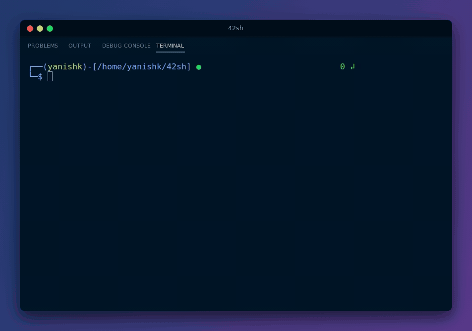
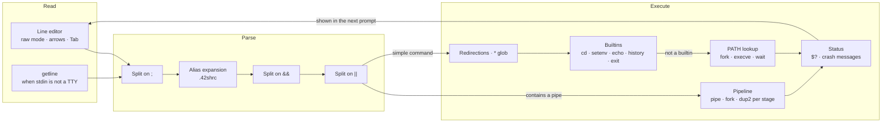

<div align="center">

# 42sh: a tcsh-like Unix shell in C

**Pipes, redirections, `&&` / `||` chains, globbing, history and aliases, written from scratch on top of `fork`, `execve`, `pipe` and `dup2`.**




[Quick start](#quick-start) · [Supported features](#supported-features) · [How it works](#how-it-works) · [Team](#team)

</div>

---

## About

42sh is the final Unix programming project of Epitech's first year. The brief: grow the *minishell* written earlier in the year into a usable interactive shell, modelled on **tcsh**, with the same builtins and the same error messages.

The result is a shell that runs programs from `PATH`, chains them with pipes, separators and redirections, expands `*` wildcards, keeps a timestamped history you can browse with the arrow keys, and reads aliases from a `.42shrc` file. It runs interactively, with its own line editor and prompt, or reads commands from a pipe.

## Highlights

- **Process control on raw system calls**: every external command is a `fork` + `execve` with `PATH` resolved by hand; pipelines are built stage by stage with `pipe` and `dup2`, and redirections swap file descriptors around the call and restore them afterwards.
- **Pipes that compose**: a pipeline can carry redirections on any stage (`ls | grep x > out`, `cat < in | wc -l`) and sit inside `&&` / `||` chains, all on the same command line.
- **Short-circuit logic**: `&&` and `||` look at the previous command's result, and a failure in one `;`-separated command doesn't stop the next one.
- **tcsh-style errors**: `Command not found.`, `Permission denied.`, `Exec format error. Wrong Architecture.`, `Segmentation fault (core dumped)`, `Floating exception`, plus tcsh's `setenv` / `cd` / `exit` messages. `$?` is 0 or 1, and 139 or 136 after a crash.
- **Custom line editor**: the terminal is switched to non-canonical mode and input is read one key at a time, which gives backspace, Up / Down history recall, Tab listing of the current directory and Ctrl+D to quit. When stdin isn't a terminal, the shell falls back to `getline`, so it also runs scripts piped into it.
- **Two-line prompt that reports the last status**: user, working directory and a green or red status code, right-aligned to the terminal width (queried with `ioctl(TIOCGWINSZ)`). With no `USER` in the environment, the user name becomes a red `marvin㉿`, after Epitech's grading bot.

## Quick start

### Prerequisites

A C compiler and `make` on Linux. On Debian / Ubuntu:

```bash
sudo apt install build-essential
```

### Build and run

```bash
git clone https://github.com/yanishk/42sh.git
cd 42sh
make            # builds ./42sh
./42sh
```

`make clean`, `make fclean` and `make re` work as usual. Commands can also be piped in:

```bash
printf 'ls -l | wc -l\nexit 3\n' | ./42sh; echo $?   # prints the line count, then 3
```

## Supported features

| Area | What works |
|------|------------|
| Execution | Programs from `PATH`, relative and absolute paths |
| Separators | `;`, `&&`, `\|\|` |
| Pipes | Any number of stages, with redirections on any stage, inside `&&` / `\|\|` chains |
| Redirections | `>` (truncate), `>>` (append), `<` (input), `<<` (here-document) |
| Globbing | `*` patterns, expanded with `glob(3)` |
| Builtins | `cd` (no argument, `~`, `-`, path), `setenv` (no argument lists the environment), `unsetenv`, `echo` (with `$VAR` and `$?`), `history`, `alias`, `exit [n]` |
| Exit status | `$?`; `exit n` sets the shell's own exit code |
| Signals | Ctrl+C interrupts the running program, not the shell; crashes are reported tcsh-style |
| Line editing (interactive) | Backspace, Up / Down history recall, Tab lists the current directory, Ctrl+D exits |
| History | Command lines are logged with a number and a timestamp to `.history_log`; `history` prints the list |
| Aliases | Read from `.42shrc` (created with `alias ls='ls --color=auto'` if missing); `alias` lists them, `alias name command...` adds one |

### Known limitations

- No quoting or escaping: arguments are split on whitespace (`echo` drops double quotes).
- Globbing only expands `*`, and only in a plain command at the start of a line (no pipe, redirection, `&&` or `||`). When commands are piped in rather than typed, such a line can be followed by stray `Command not found.` errors at end of input.
- An alias is only expanded when it is the whole command, so `ll` works but `ll src` doesn't.
- Builtins (`cd`, `setenv`, ...) don't run inside a pipeline, and the `!` history shortcuts aren't implemented.
- `.history_log`, `.42shrc` and the here-document buffer `.temp.txt` live in the current directory, so they follow `cd`. A here-document also passes a stray NUL byte after each line.
- `env` prints the environment twice: the builtin runs, then `/usr/bin/env`. `setenv` with no argument prints it once.

## How it works



Each line is split on `;`, aliases are substituted, then every command is split on `&&` and `||`. A part is only run if the previous one's result allows it (success after `&&`, failure after `||`). A part that contains `|` becomes a pipeline: one child per stage, each with its stdin and stdout wired with `dup2` and its own redirections. Otherwise the shell applies any redirection, expands `*`, tries the builtins and finally resolves the program in `PATH` and runs it with `fork` + `execve`. The child's status is decoded (`WIFSIGNALED`, `WCOREDUMP`) into tcsh's crash messages and into `$?`, which the next prompt displays.

```
main.c               Entry point: flags, SIGINT handler, main loop
src/input/           Read loop: line editor (TTY) or getline (pipe), Tab listing
src/arrow/           Up / Down history recall
src/alias/           .42shrc parsing, alias expansion, alias builtin
src/launch_commands.c, src/last_command_status.c
                     Splitting on && and ||, short-circuit logic
src/pipe/            Pipelines, with redirections on any stage
src/redirection.c    > >> < << for single commands
src/glob_exe.c       * expansion
src/execute_binary.c, src/find_exec.c, src/loop_buffer.c
                     Builtin dispatch, PATH lookup, fork / execve
src/error_handling.c Signal and crash reporting
src/env/, src/echo/, src/history/, src/creating_cd.c, src/exit_shell.c
                     Builtins
src/display_prompt/  Two-line prompt sized to the terminal
src/binary_flag/     --help, --list, --list-op
lib/                 String helpers and the delimiter-aware tokenizer (word_array*)
include/             Prototypes (my.h) and the shared shell state (stockage.h)
```

## Team

Built in three weeks (April to May 2023) by four Epitech students:

| | Main areas |
|---|---|
| [**Yanis Harkouk**](https://github.com/yanishk) | Delimiter-aware tokenizer, `&&` / `\|\|` separators and short-circuit logic, pipelines with redirections and inside `&&` / `\|\|` chains, `setenv` / `unsetenv`, `echo` with `$VAR` and `$?`, `exit` with status, permission and empty-command handling, shared shell state |
| [**Eva Legrand**](https://github.com/Chaegnal) | Initial shell base (execution, `PATH` lookup, `cd`, output redirections, first pipes), project structure and string library, `<` and `<<` redirections, `*` globbing, command-not-found vs. wrong-architecture errors, Tab listing |
| [**Wilson Bordichon**](https://github.com/Wilson-Epitech) | The shell's look: coloured two-line prompt (user, directory, status dot and exit code, fitted to the terminal width) and colour helpers, history (`history` builtin, numbered and timestamped `.history_log`, coloured output), `PATH` / `env` handling, `--help` / `--list` / `--list-op` flags |
| [**Mathis Brehm**](https://github.com/mathisbdkr) | Aliases (`.42shrc`, `alias` builtin, chained aliases), raw-mode line editor with arrow-key history recall, input module, memory clean-up |

## License

Educational project (Epitech, 2023).
